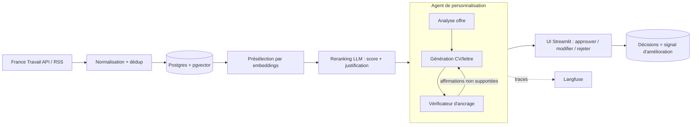

# Job Copilot

Copilote de candidature **agentique** avec **humain dans la boucle** et une vraie démarche **LLMOps** :
ingestion d'offres → matching (embeddings + reranking LLM) → agent de personnalisation avec
**vérificateur d'ancrage** (zéro invention) → validation humaine → évals, traçage et coûts mesurés.

> Principe : l'agent prépare tout, **tu valides avant tout envoi**. Aucun envoi automatique,
> aucun scraping de LinkedIn/Indeed (CGU).

## Architecture



## Démarrage rapide

```bash
cp .env.example .env                          # clés API, Langfuse, France Travail
cp data/profile.example.yaml data/profile.yaml   # TON CV structuré (chaque puce = une preuve)
make install
make up                                       # Postgres (pgvector) + API :8000 + UI :8501
```

Sans Docker : lance Postgres avec l'extension `pgvector`, puis `make api` et `make ui`.
Embeddings locaux : `ollama pull bge-m3`. Clés France Travail : <https://francetravail.io>.

## LLMOps : ce qui est en place

| Brique | Où |
|---|---|
| Prompts versionnés (hash du contenu stocké avec chaque résultat) | `src/job_copilot/prompts/` |
| Sorties JSON validées par Pydantic, avec retry | `src/job_copilot/llm.py` |
| Routage de modèles (rapide : tri / fort : rédaction + vérif) | `.env` → `LLM_FAST_MODEL`, `LLM_STRONG_MODEL` |
| Suivi tokens / coût / latence par candidature | `llm.track()`, stocké dans `drafts.usage` |
| Traçage de chaque appel | Langfuse via callbacks LiteLLM |
| Garde-fous anti-hallucination | `agents/grounding.py` (LLM + garde-fou numérique déterministe) |
| Évals reproductibles + CI | `evals/`, `.github/workflows/ci.yml` |
| Boucle d'amélioration | chaque approbation/rejet/édition est stockée (`drafts`) |

## Évaluer (la partie qui fait la différence)

1. Annote 100-200 offres dans `evals/data/offers_labeled.jsonl` (0 hors sujet, 1 acceptable, 2 excellent) — voir `.example.jsonl`.
2. `make eval-match` → précision@5, MRR, nDCG@10.
3. `make eval-grounding` → taux d'affirmations non supportées **sans** vs **avec** la boucle de vérification, jugé par un modèle indépendant, avec le coût moyen par candidature.
4. Publie les chiffres dans `docs/` : c'est ton rapport d'évaluation.

## Feuille de route

- **V0 (ce repo)** : ingestion, matching, agent + vérificateur, UI de validation, évals, traçage.
- **V1** : suivi des candidatures (CRM léger, relances), préparation d'entretien sur l'entreprise.
- **V2** : fine-tuning/distillation d'un petit modèle de matching à partir de tes décisions, dérive et monitoring en continu, A/B de prompts.

## Structure

```
src/job_copilot/
  ingestion/   connecteurs France Travail + RSS, normalisation, dédup
  matching/    reranking LLM
  agents/      graphe LangGraph + vérificateur d'ancrage
  prompts/v1/  prompts versionnés
  api/         FastAPI        ui/  Streamlit
  db.py services.py llm.py observability.py
evals/         datasets, métriques, scripts d'éval
tests/         tests unitaires (sans réseau, LLM simulé)
infra/         docker-compose
```
